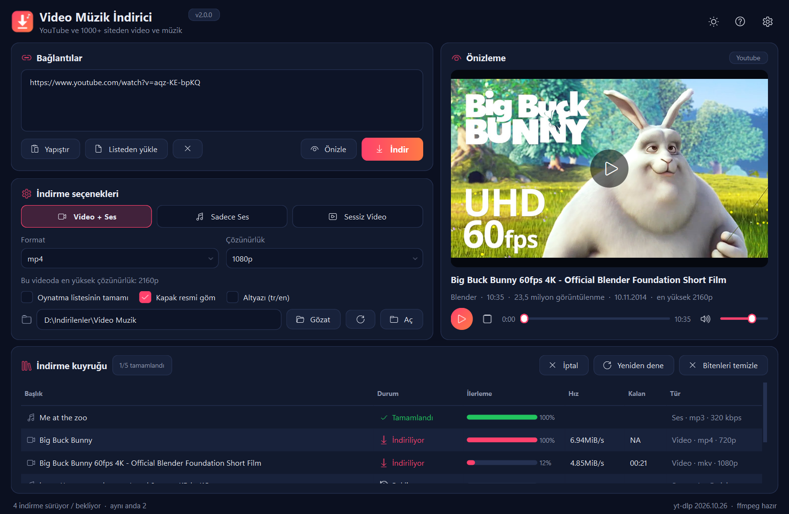
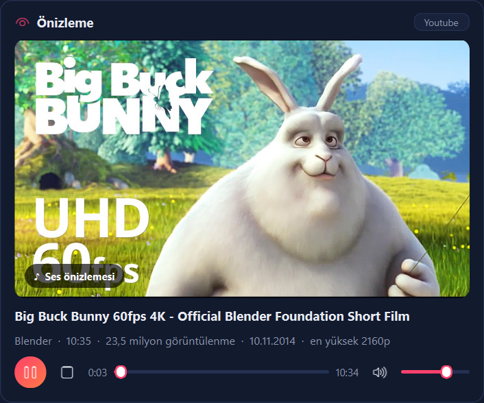
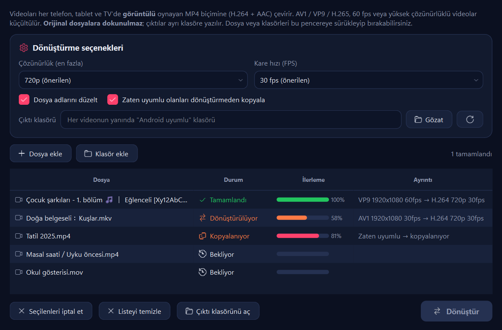

<div align="center">


# Video Müzik İndirici

**YouTube ve 1000'den fazla siteden video ve müzik indirmek için modern, Türkçe bir Windows uygulaması.**

İndirmeden önce **izleyin ve dinleyin**, formatı ve kaliteyi seçin, arka planda indirin. Uygulama kendini GitHub'dan **otomatik günceller**.
[yt-dlp](https://github.com/yt-dlp/yt-dlp) ve [FFmpeg](https://ffmpeg.org/) üzerine kuruludur; kurulum gerektirmez, tek bir `.exe` dosyasıdır.

[](https://github.com/mehmet-cizmeci/video-muzik-indirici/releases/latest)
[](https://github.com/mehmet-cizmeci/video-muzik-indirici/releases)
[](LICENSE)


**[⬇ Son sürümü indir](https://github.com/mehmet-cizmeci/video-muzik-indirici/releases/latest)** ·
[Kullanım Kılavuzu](docs/KULLANIM-KILAVUZU.md) ·
[Sık Sorulan Sorular](docs/SSS.md) ·
[Teknik Bilgi](docs/TEKNIK.md)



</div>

---

## İçindekiler

- [Özellikler](#özellikler)
- [Hızlı başlangıç](#hızlı-başlangıç)
- [Kısaca kullanım](#kısaca-kullanım)
- [Önizleme](#önizleme)
- [Otomatik güncelleme](#otomatik-güncelleme)
- [Desteklenen formatlar](#desteklenen-formatlar)
- [Android uyumluluğu ve MP4 dönüştürücü](#android-uyumluluğu-ve-mp4-dönüştürücü)
- [Kesintiye dayanıklı indirme](#kesintiye-dayanıklı-indirme)
- [Sistem gereksinimleri](#sistem-gereksinimleri)
- [Kaynaktan çalıştırma ve derleme](#kaynaktan-çalıştırma-ve-derleme)
- [Dokümantasyon](#dokümantasyon)
- [Yasal uyarı](#yasal-uyarı)
- [Lisans ve teşekkür](#lisans-ve-teşekkür)

## Özellikler

| | |
|---|---|
| 🎨 **Modern arayüz** | Kartlı, sade tasarım; **koyu ve açık tema** (tek tıkla değişir), Windows 11 ikonları. |
| 👁 **Video ve ses önizleme** | Bağlantıyı yapıştırınca başlık, kanal, süre, küçük resim ve mevcut en yüksek çözünürlük otomatik gelir. ▶ ile **indirmeden izleyin veya dinleyin**. İnen dosyalar da uygulama içinde oynatılır. |
| 🔄 **Kendini güncelleyen uygulama** | Yeni sürüm çıkınca haber verir; tek tıkla indirir, doğrular ve yeniden başlar. İndirmeler kaldığı yerden sürer. |
| 🔗 **Tek URL veya liste** | Tek bir bağlantı, her satıra bir bağlantı, `.txt` dosyasından liste ya da tarayıcıdan **sürükle-bırak**. |
| 🎬 **Üç indirme türü** | Video + Ses, Sadece Ses (müzik), Sessiz Video. |
| 📱 **Her cihazda görüntülü** | Varsayılan **Android uyumlu** mod: H.264 MP4, 30 fps. Telefon, tablet ve TV'de "ses var, görüntü yok" sorunu yaşanmaz. Bozuk dosya adları otomatik düzeltilir. |
| 🔁 **MP4 Dönüştürücü** | Bilgisayardaki videoları (mkv, webm, avi, mov…) tek tıkla uyumlu MP4'e çevirir; orijinallere dokunmaz. |
| 🎚 **Format ve kalite** | Video: mp4, mkv, webm — 4K'dan 240p'ye. Ses: mp3, m4a, opus, flac, wav — 320 kbps'ye kadar. |
| ⏳ **Arka planda kuyruk** | İndirmeler sırayla ve arka planda yürür; aynı anda 1–5 indirme. İlerleme çubukları, hız ve kalan süre. |
| 📶 **Kesintiye dayanıklı** | İnternet koparsa bekler, gelince **kaldığı yerden** devam eder; uyku sonrası takılan indirmeleri kendisi yeniden başlatır. |
| 💾 **Kapatınca kaybolmaz** | Uygulama kapansa veya bilgisayar yeniden başlasa bile yarım kalan indirmeler sonraki açılışta sürer. |
| 😴 **Uyku engelleme** | İndirme sürerken Windows'un kendiliğinden uykuya geçmesini engeller (isteğe bağlı). |
| 📃 **Oynatma listeleri** | Listenin tamamını, liste adlı klasöre sıra numarasıyla indirir. |
| 🖼 **Kapak ve etiket** | Kapak resmi ve başlık/sanatçı bilgisi dosyaya gömülür; isteğe bağlı Türkçe/İngilizce altyazı. |
| 🧰 **Sıfır kurulum** | yt-dlp veya FFmpeg yoksa ilk açılışta kendisi indirir; yt-dlp'yi günde bir otomatik günceller. |

## Hızlı başlangıç

1. **[Releases](https://github.com/mehmet-cizmeci/video-muzik-indirici/releases/latest)** sayfasından `VideoMuzikIndirici.exe` dosyasını indirin.
2. Dosyayı istediğiniz bir klasöre (örneğin Masaüstü) koyup çift tıklayın.
3. İlk açılışta yt-dlp ve FFmpeg bilgisayarda yoksa otomatik indirilir (~140 MB, bir kereliğine).
4. Bağlantıyı yapıştırın, önizlemeye bakın, **İndir**'e basın.

> [!NOTE]
> **"Windows bilgisayarınızı korudu" uyarısı çıkarsa:** Uygulama ücretli bir kod imzalama sertifikasıyla imzalanmadığı için Windows SmartScreen ilk çalıştırmada uyarı gösterebilir. **Ek bilgi → Yine de çalıştır** seçeneğine tıklayın. Ayrıntılar: [SSS](docs/SSS.md#windows-bilgisayarınızı-korudu-uyarısı-çıkıyor), [İmza durumu](docs/IMZALAMA.md).

> [!TIP]
> **1.x sürümünden geçiş:** 1.0.0 kendini güncelleyemez; son sürümü bir kez elle indirip eski exe'nin yerine koyun. Ayarlarınız ve yarım kalan indirmeleriniz korunur. Bundan sonraki sürümler otomatik gelir.

## Kısaca kullanım

```
1. Bağlantıyı yapıştırın        →  "Yapıştır", Ctrl+V ya da tarayıcıdan sürükleyip bırakın
2. Önizlemeye bakın             →  bilgiler otomatik gelir; ▶ ile izleyin / dinleyin
3. Türü seçin                   →  Video + Ses / Sadece Ses / Sessiz Video
4. Format ve kaliteyi seçin     →  örn. mp4 · 1080p  ya da  mp3 · 320 kbps
5. İndirin                      →  "İndir"  ya da Ctrl+Enter
```

Biten bir indirmeye **çift tıklayınca** dosya önizleme panelinde oynatılır. Satıra **sağ tıklayınca** dosyayı açma, klasörde gösterme, iptal, yeniden deneme ve hata ayrıntısı seçenekleri çıkar.

Tüm ayrıntılar: **[📖 Kullanım Kılavuzu](docs/KULLANIM-KILAVUZU.md)**

## Önizleme



- Kutuya **tek bir bağlantı** yapıştırdığınızda bilgiler kendiliğinden gelir: başlık, kanal, süre, görüntülenme, tarih, küçük resim ve videodaki **en yüksek çözünürlük**.
- **▶** düğmesi videoyu indirmeden uygulama içinde oynatır. **Sadece Ses** seçiliyse yalnızca ses çalınır ("Ses önizlemesi").
- Oynatma listelerinde listenin adı, öğe sayısı ve ilk öğe gösterilir.
- Kuyrukta **tamamlanan** bir dosyaya çift tıklayınca o dosya önizlemede oynar.
- Ses düzeyi, ileri-geri sarma ve durdurma denetimleri vardır.

<br clear="right">

## Otomatik güncelleme

- Uygulama açılırken GitHub'daki son sürümü denetler. Yeni sürüm varsa sağ üstte yeşil **"Yeni sürüm x.y.z"** düğmesi belirir.
- Düğmeye basınca sürüm notları görünür. **Şimdi güncelle** dediğinizde yeni exe indirilir, **SHA-256 özeti doğrulanır**, uygulama kendini değiştirip yeniden açılır.
- Sürüyor olan indirmeler kaydedilir ve yeniden açılışta **kaldığı yerden** devam eder.
- İsterseniz bir sürümü atlayabilir, otomatik denetimi **Ayarlar**'dan kapatıp **Uygulama güncellemesini denetle** ile elle denetleyebilirsiniz.
- İndirme motoru **yt-dlp** de ayrıca günde bir kez otomatik güncellenir.

## Desteklenen formatlar

| Tür | Formatlar | Kalite seçenekleri |
|---|---|---|
| Video + Ses | `mp4` (en uyumlu), `mkv`, `webm` | En iyi, 2160p (4K), 1440p, 1080p, 720p, 480p, 360p, 240p |
| Sadece Ses | `mp3` (en uyumlu), `m4a`, `opus`, `flac`, `wav` | En iyi, 320, 256, 192, 128, 96 kbps |
| Sessiz Video | `mp4`, `mkv`, `webm` (ses yok) | Video ile aynı |

Seçilen çözünürlük bir **üst sınırdır**: video o çözünürlükte yoksa altındaki en iyi kalite indirilir. Önizleme, videodaki en yüksek çözünürlüğü gösterir.

Desteklenen siteler: YouTube, YouTube Music, Vimeo, Dailymotion, SoundCloud, Twitter/X, Instagram, TikTok, Facebook, Twitch ve [yt-dlp'nin desteklediği 1000'den fazla site](https://github.com/yt-dlp/yt-dlp/blob/master/supportedsites.md).

## Android uyumluluğu ve MP4 dönüştürücü

YouTube artık birçok videoyu **AV1** biçiminde veriyor. Android 9 ve öncesi bu biçimi oynatamaz; eski veya düşük güçlü cihazlar da **1080p / 60 fps** videolarda görüntüyü gösteremeyebilir. Sonuç: **ses gelir, görüntü gelmez.** Emojili veya `｜ ⧸ ：` gibi karakterli dosya adları da bazı telefonlarda dosyanın (hatta klasörün) görünmemesine yol açar.

| Seçenek | Varsayılan | Açıklama |
|---|---|---|
| **Uyumluluk** | Android uyumlu (H.264) | H.264 + AAC MP4 indirilir; gelen video yine de uyumsuzsa indirme sonunda otomatik dönüştürülür. *Orijinal* seçilirse sitenin en iyi biçimi (AV1/VP9 olabilir) iner. |
| **Kare hızı (FPS)** | 30 fps | 25 fps, Orijinal veya 60 fps de seçilebilir. 25/30 fps her cihazda akıcıdır. |
| **Adları düzelt** | Açık | Emoji, garip karakterler ve sondaki `[video kimliği]` dosya adından temizlenir. |



**MP4 Dönüştürücü** (üst çubuktaki düğme) aynı işlemi bilgisayardaki videolara uygular: dosya veya klasör ekleyin (ya da sürükleyin), çözünürlük (720p önerilir) ve FPS sınırını seçin, **Dönüştür**'e basın. Zaten uyumlu olan videolar kalite kaybı olmadan kopyalanır. Orijinal dosyalara dokunulmaz; çıktılar varsayılan olarak videonun yanındaki **`Android uyumlu`** klasörüne yazılır.

Dönüştürme ayarları: H.264 (Main profil), en fazla seçilen çözünürlük ve FPS, AAC ses, hızlı başlatma (`+faststart`).

## Kesintiye dayanıklı indirme

| Durum | Uygulamanın davranışı |
|---|---|
| İnternet bağlantısı koptu | Satırda **"Bağlantı bekleniyor…"** yazar. Bağlantı gelince yarım dosyadan **kaldığı yerden** devam eder. |
| İndirme takıldı (veri gelmiyor) | 90 saniye veri gelmezse indirmeyi otomatik yeniden başlatır (yine kaldığı yerden). |
| Bilgisayar uykuya geçti / uyandı | Uyanınca takılan indirmeleri algılar ve sürdürür. İndirme sırasında otomatik uykuyu engeller. |
| Uygulama kapatıldı / güncellendi / bilgisayar yeniden başladı | Yarım kalan indirmeler kaydedilir; uygulama açılınca kendiliğinden devam eder. |
| Geçici sunucu hatası | Artan bekleme süreleriyle (5 sn → 2 dk) yeniden dener. |
| Kalıcı hata (video silinmiş, gizli, geçersiz adres) | Boşuna denemez, **Hata** olarak işaretler; çift tıklayınca sebebi görünür. |

## Sistem gereksinimleri

- Windows 10 veya Windows 11 (64 bit)
- İnternet bağlantısı
- Uygulama ~55 MB; ilk açılışta yt-dlp + FFmpeg için ~400 MB boş alan

## Kaynaktan çalıştırma ve derleme

Python 3.9 veya üstü ve **PySide6** gerekir.

```bash
git clone https://github.com/mehmet-cizmeci/video-muzik-indirici.git
cd video-muzik-indirici
python -m pip install pyside6
python indirici.pyw
```

Tek dosyalık `.exe` derlemek için `build.bat` dosyasını çalıştırın; sonuç `dist\VideoMuzikIndirici.exe` ve güncelleyicinin doğrulaması için `dist\VideoMuzikIndirici.exe.sha256` olur. Ayrıntılar: [Teknik Bilgi](docs/TEKNIK.md#kaynaktan-derleme).

## Dokümantasyon

| Belge | İçerik |
|---|---|
| [📖 Kullanım Kılavuzu](docs/KULLANIM-KILAVUZU.md) | Ekranın her bölümü, önizleme, indirme, kuyruk, ayarlar, güncelleme, ipuçları |
| [❓ Sık Sorulan Sorular ve Sorun Giderme](docs/SSS.md) | Hata mesajları, SmartScreen uyarısı, önizleme ve güncelleme sorunları |
| [⚙ Teknik Bilgi](docs/TEKNIK.md) | Mimari, dosya konumları, yt-dlp ayarları, güncelleme mekanizması, derleme |
| [🔏 Dijital İmza Rehberi](docs/IMZALAMA.md) | İmza durumu (exe şu an imzasız) ve ileride imzalama altyapısı |
| [📝 Değişiklik Günlüğü](CHANGELOG.md) | Sürüm geçmişi |

## Yasal uyarı

Bu yazılım yalnızca **kişisel kullanım** ve **indirme hakkına sahip olduğunuz** içerikler (kendi videolarınız, Creative Commons / kamu malı içerikler, izin verilmiş içerikler vb.) için tasarlanmıştır. Telif hakkıyla korunan içerikleri izinsiz indirmek ve dağıtmak yasalara ve ilgili platformların kullanım koşullarına aykırı olabilir. Yazılımın kullanımından doğan tüm sorumluluk kullanıcıya aittir.

## Lisans ve teşekkür

Bu proje [MIT Lisansı](LICENSE) ile yayınlanmıştır.

- **[yt-dlp](https://github.com/yt-dlp/yt-dlp)** — video/ses indirme motoru (Unlicense)
- **[FFmpeg](https://ffmpeg.org/)** — birleştirme ve dönüştürme ([yt-dlp/FFmpeg-Builds](https://github.com/yt-dlp/FFmpeg-Builds), GPL)
- **[Qt / PySide6](https://www.qt.io/qt-for-python)** — arayüz ve oynatıcı (LGPL)
- **[PyInstaller](https://pyinstaller.org/)** — tek dosyalık exe paketleme

yt-dlp ve FFmpeg bu depoda **bulunmaz**; uygulama ihtiyaç duyduğunda bunları kendi resmi sürüm sayfalarından indirir.
