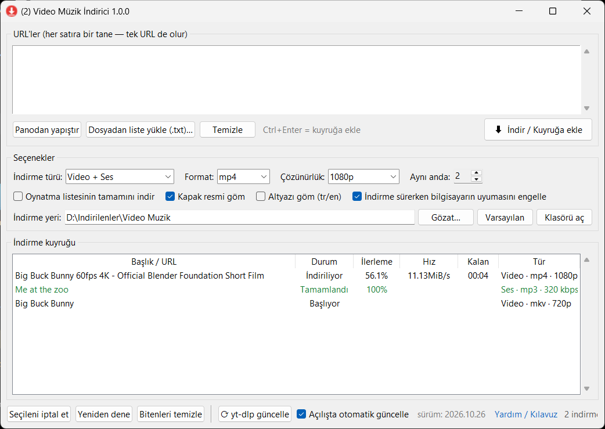

<div align="center">


# Video Müzik İndirici

**YouTube ve 1000'den fazla siteden video ve müzik indirmek için sade, Türkçe bir Windows masaüstü uygulaması.**

[yt-dlp](https://github.com/yt-dlp/yt-dlp) ve [FFmpeg](https://ffmpeg.org/) üzerine kuruludur. Kurulum gerektirmez; tek bir `.exe` dosyasıdır.

[](https://github.com/mehmet-cizmeci/video-muzik-indirici/releases/latest)
[](https://github.com/mehmet-cizmeci/video-muzik-indirici/releases)
[](LICENSE)


**[⬇ Son sürümü indir](https://github.com/mehmet-cizmeci/video-muzik-indirici/releases/latest)** ·
[Kullanım Kılavuzu](docs/KULLANIM-KILAVUZU.md) ·
[Sık Sorulan Sorular](docs/SSS.md) ·
[Teknik Bilgi](docs/TEKNIK.md)



</div>

---

## İçindekiler

- [Özellikler](#özellikler)
- [Hızlı başlangıç](#hızlı-başlangıç)
- [Kısaca kullanım](#kısaca-kullanım)
- [Desteklenen formatlar](#desteklenen-formatlar)
- [Kesintiye dayanıklı indirme](#kesintiye-dayanıklı-indirme)
- [Sistem gereksinimleri](#sistem-gereksinimleri)
- [Kaynaktan çalıştırma ve derleme](#kaynaktan-çalıştırma-ve-derleme)
- [Dokümantasyon](#dokümantasyon)
- [Yasal uyarı](#yasal-uyarı)
- [Lisans ve teşekkür](#lisans-ve-teşekkür)

## Özellikler

| | |
|---|---|
| 🔗 **Tek URL veya liste** | Tek bir bağlantı yapıştırın ya da her satıra bir bağlantı yazın. `.txt` dosyasından toplu liste yükleyebilirsiniz. |
| 🎬 **Üç indirme türü** | Video + Ses, Sadece Ses (müzik), Sadece Video (sessiz). |
| 🎚 **Format ve kalite seçimi** | Video: mp4, mkv, webm — 4K'dan 240p'ye. Ses: mp3, m4a, opus, flac, wav — 320 kbps'ye kadar. |
| 📂 **İndirme yeri** | Varsayılan olarak `İndirilenler\Video Muzik Indirici`. İstediğiniz klasörü seçebilirsiniz, seçim hatırlanır. |
| ⏳ **Arka planda kuyruk** | İndirmeler sırayla ve arka planda yürür; aynı anda kaç indirme yapılacağını (1–5) siz seçersiniz. Arayüz donmaz. |
| 📶 **Kesintiye dayanıklı** | İnternet koparsa bekler, gelince **kaldığı yerden** devam eder. Uyku sonrası takılan indirmeleri kendisi yeniden başlatır. |
| 💾 **Kapatınca kaybolmaz** | Uygulamayı kapatsanız veya bilgisayar yeniden başlasa bile yarım kalan indirmeler bir sonraki açılışta otomatik sürer. |
| 😴 **Uyku engelleme** | İndirme sürerken Windows'un kendiliğinden uykuya geçmesini engeller (isteğe bağlı). |
| 📃 **Oynatma listeleri** | YouTube listelerinin tamamını, listenin adını taşıyan bir klasöre sıra numarasıyla indirir. |
| 🖼 **Kapak ve bilgi etiketi** | Kapak resmini ve başlık/sanatçı bilgisini dosyaya gömer. İsteğe bağlı Türkçe/İngilizce altyazı. |
| 🔄 **Kendini güncel tutar** | yt-dlp'yi tek tıkla ya da açılışta otomatik (günde bir) günceller. |
| 🧰 **Sıfır kurulum** | Bilgisayarda yt-dlp veya FFmpeg yoksa ilk açılışta kendisi indirip kurar. Yönetici izni gerekmez. |

## Hızlı başlangıç

1. **[Releases](https://github.com/mehmet-cizmeci/video-muzik-indirici/releases/latest)** sayfasından `VideoMuzikIndirici.exe` dosyasını indirin.
2. Dosyayı istediğiniz bir klasöre koyun (örneğin Masaüstü) ve çift tıklayın.
3. İlk açılışta yt-dlp ve FFmpeg bilgisayarda yoksa otomatik olarak indirilir (~140 MB, bir kereliğine).
4. Bağlantıyı yapıştırın, **⬇ İndir / Kuyruğa ekle** düğmesine basın. Bu kadar!

> [!NOTE]
> **"Windows bilgisayarınızı korudu" uyarısı çıkarsa:** Uygulama dijital olarak imzalanmadığı için Windows SmartScreen ilk çalıştırmada uyarı gösterebilir. **Ek bilgi → Yine de çalıştır** seçeneğine tıklayın. Ayrıntılar için [SSS](docs/SSS.md#windows-bilgisayarınızı-korudu-uyarısı-çıkıyor).

## Kısaca kullanım

```
1. URL'yi yapıştırın          →  "Panodan yapıştır" ya da Ctrl+V
2. Türü seçin                 →  Video + Ses / Sadece Ses / Sadece Video
3. Format ve kaliteyi seçin   →  örn. mp4 · 1080p  ya da  mp3 · 320 kbps
4. (İsteğe bağlı) klasör seçin →  "Gözat…"
5. İndir                      →  "⬇ İndir / Kuyruğa ekle"  ya da Ctrl+Enter
```

Biten bir indirmeye **çift tıklayınca** dosya klasörde gösterilir. Satıra **sağ tıklayınca** dosyayı açma, iptal, yeniden deneme ve hata ayrıntısı seçenekleri çıkar.

Tüm ayrıntılar, ekran açıklamaları ve ipuçları için: **[📖 Kullanım Kılavuzu](docs/KULLANIM-KILAVUZU.md)**

## Desteklenen formatlar

| Tür | Formatlar | Kalite seçenekleri |
|---|---|---|
| Video + Ses | `mp4` (en uyumlu), `mkv`, `webm` | En iyi, 2160p (4K), 1440p, 1080p, 720p, 480p, 360p, 240p |
| Sadece Ses | `mp3` (en uyumlu), `m4a`, `opus`, `flac`, `wav` | En iyi, 320, 256, 192, 128, 96 kbps |
| Sadece Video | `mp4`, `mkv`, `webm` (ses yok) | Video ile aynı |

Seçilen çözünürlük bir **üst sınırdır**: video o çözünürlükte yoksa, altındaki en iyi kalite indirilir.

Desteklenen siteler: YouTube, YouTube Music, Vimeo, Dailymotion, SoundCloud, Twitter/X, Instagram, TikTok, Facebook, Twitch ve [yt-dlp'nin desteklediği 1000'den fazla site](https://github.com/yt-dlp/yt-dlp/blob/master/supportedsites.md).

## Kesintiye dayanıklı indirme

Video Müzik İndirici, uzun ve kalabalık indirme listelerinin gece boyunca bile sorunsuz bitmesi için tasarlandı:

| Durum | Uygulamanın davranışı |
|---|---|
| İnternet bağlantısı koptu | Satırda **"Bağlantı bekleniyor…"** yazar. Bağlantı gelince yarım dosyadan **kaldığı yerden** devam eder. |
| İndirme takıldı (veri gelmiyor) | 90 saniye veri gelmezse indirmeyi otomatik yeniden başlatır (yine kaldığı yerden). |
| Bilgisayar uykuya geçti / uyandı | Uyanınca takılan indirmeleri algılar ve sürdürür. İndirme sırasında otomatik uykuyu engeller. |
| Uygulama kapatıldı / bilgisayar yeniden başladı | Yarım kalan indirmeler kaydedilir; uygulamayı açtığınızda kendiliğinden devam eder. |
| Geçici sunucu hatası | Artan bekleme süreleriyle (5 sn → 2 dk) yeniden dener. |
| Kalıcı hata (video silinmiş, gizli, geçersiz adres) | Boşuna denemez, **Hata** olarak işaretler; sağ tık → *Hata ayrıntısı* ile sebebi görebilirsiniz. |

## Sistem gereksinimleri

- Windows 10 veya Windows 11 (64 bit)
- İnternet bağlantısı
- İlk açılış için ~400 MB boş alan (yt-dlp + FFmpeg) ve indirmeleriniz için yeterli disk alanı

## Kaynaktan çalıştırma ve derleme

Python 3.9 veya üstü (tkinter dahil) yeterlidir; ek kütüphane gerekmez.

```bash
git clone https://github.com/mehmet-cizmeci/video-muzik-indirici.git
cd video-muzik-indirici
python indirici.pyw
```

Tek dosyalık `.exe` derlemek için `build.bat` dosyasını çalıştırın; sonuç `dist\VideoMuzikIndirici.exe` olur. Ayrıntılar: [Teknik Bilgi](docs/TEKNIK.md#kaynaktan-derleme).

## Dokümantasyon

| Belge | İçerik |
|---|---|
| [📖 Kullanım Kılavuzu](docs/KULLANIM-KILAVUZU.md) | Ekranın her bölümü, adım adım indirme, listeler, oynatma listeleri, ipuçları |
| [❓ Sık Sorulan Sorular ve Sorun Giderme](docs/SSS.md) | Hata mesajları, SmartScreen uyarısı, yavaş indirme, format seçimi |
| [⚙ Teknik Bilgi](docs/TEKNIK.md) | Nasıl çalışır, dosya konumları, kullanılan yt-dlp ayarları, derleme |
| [📝 Değişiklik Günlüğü](CHANGELOG.md) | Sürüm geçmişi |

## Yasal uyarı

Bu yazılım yalnızca **kişisel kullanım** ve **indirme hakkına sahip olduğunuz** içerikler (kendi videolarınız, Creative Commons / kamu malı içerikler, izin verilmiş içerikler vb.) için tasarlanmıştır. Telif hakkıyla korunan içerikleri izinsiz indirmek ve dağıtmak yasalara ve ilgili platformların kullanım koşullarına aykırı olabilir. Yazılımın kullanımından doğan tüm sorumluluk kullanıcıya aittir.

## Lisans ve teşekkür

Bu proje [MIT Lisansı](LICENSE) ile yayınlanmıştır.

Asıl işi yapan harika açık kaynak projelere teşekkürler:

- **[yt-dlp](https://github.com/yt-dlp/yt-dlp)** — video/ses indirme motoru (Unlicense)
- **[FFmpeg](https://ffmpeg.org/)** — birleştirme ve dönüştürme ([yt-dlp/FFmpeg-Builds](https://github.com/yt-dlp/FFmpeg-Builds), GPL)
- **[PyInstaller](https://pyinstaller.org/)** — tek dosyalık exe paketleme

yt-dlp ve FFmpeg bu depoda **bulunmaz**; uygulama ihtiyaç duyduğunda bunları kendi resmi sürüm sayfalarından indirir.
