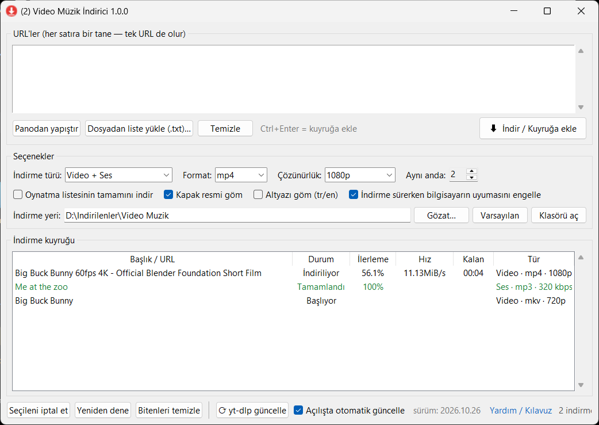

# 📖 Kullanım Kılavuzu

[← Ana sayfa](../README.md) · [Sık Sorulan Sorular](SSS.md) · [Teknik Bilgi](TEKNIK.md)

Bu kılavuz Video Müzik İndirici'nin tüm özelliklerini adım adım anlatır.

## İçindekiler

1. [Kurulum ve ilk açılış](#1-kurulum-ve-ilk-açılış)
2. [Ekranı tanıyalım](#2-ekranı-tanıyalım)
3. [İlk indirmeniz (adım adım)](#3-ilk-indirmeniz-adım-adım)
4. [Birden fazla bağlantıyı indirmek](#4-birden-fazla-bağlantıyı-indirmek)
5. [Müzik (sadece ses) indirmek](#5-müzik-sadece-ses-indirmek)
6. [Oynatma listesi indirmek](#6-oynatma-listesi-indirmek)
7. [İndirme kuyruğunu yönetmek](#7-indirme-kuyruğunu-yönetmek)
8. [İndirme yerini değiştirmek](#8-indirme-yerini-değiştirmek)
9. [Bağlantı kopması, uyku ve kapatma](#9-bağlantı-kopması-uyku-ve-kapatma)
10. [yt-dlp'yi güncellemek](#10-yt-dlpyi-güncellemek)
11. [Hangi formatı seçmeliyim?](#11-hangi-formatı-seçmeliyim)
12. [Klavye kısayolları](#12-klavye-kısayolları)
13. [İpuçları](#13-ipuçları)

---

## 1. Kurulum ve ilk açılış

Video Müzik İndirici kurulum gerektirmez.

1. [Releases sayfasından](https://github.com/mehmet-cizmeci/video-muzik-indirici/releases/latest) **`VideoMuzikIndirici.exe`** dosyasını indirin.
2. Dosyayı kalıcı olarak durmasını istediğiniz bir yere taşıyın (örn. `Belgeler\Programlar` veya Masaüstü).
3. Çift tıklayarak açın.

> **SmartScreen uyarısı:** "Windows bilgisayarınızı korudu" penceresi çıkarsa **Ek bilgi** bağlantısına, ardından **Yine de çalıştır** düğmesine tıklayın. Bu uyarı, uygulamanın ücretli bir dijital sertifikayla imzalanmamasından kaynaklanır; yalnızca ilk çalıştırmada görünür.

### İlk açılışta otomatik kurulum

Uygulamanın çalışması için iki yardımcı programa ihtiyaç vardır:

| Program | Görevi |
|---|---|
| **yt-dlp** | Videoyu siteden bulur ve indirir |
| **FFmpeg** | Görüntü ve sesi birleştirir, mp3 gibi formatlara dönüştürür, kapak resmi ekler |

Bilgisayarınızda bunlar yoksa uygulama ilk açılışta bir ilerleme penceresi göstererek ikisini de **otomatik indirir** (toplam ~140 MB). Bu işlem bir kez yapılır; yönetici izni istemez. Dosyalar `%LOCALAPPDATA%\VideoMuzikIndirici\bin` klasörüne kaydedilir.

İnternet bağlantınız yoksa ya da indirme başarısız olursa **Tekrar dene** seçeneği sunulur.

> Masaüstüne kısayol koymak için: exe dosyasına sağ tıklayın → **Daha fazla seçenek göster** → **Gönder** → **Masaüstü (kısayol oluştur)**.

---

## 2. Ekranı tanıyalım



Ekran yukarıdan aşağıya dört bölümden oluşur:

### ① URL'ler kutusu

İndirmek istediğiniz bağlantıları buraya yazarsınız. **Her satıra bir bağlantı**. Tek bağlantı da olur, yüzlerce bağlantı da.

| Düğme | Ne yapar |
|---|---|
| **Panodan yapıştır** | Kopyaladığınız bağlantıyı kutuya ekler (Ctrl+V ile de yapıştırabilirsiniz) |
| **Dosyadan liste yükle (.txt)…** | İçinde her satırda bir bağlantı olan bir metin dosyasını kutuya aktarır |
| **Temizle** | Kutuyu boşaltır |
| **⬇ İndir / Kuyruğa ekle** | Kutudaki tüm bağlantıları seçili ayarlarla indirme kuyruğuna ekler ve indirmeyi başlatır |

> Aynı bağlantıyı iki kez yazarsanız bir kez eklenir. `#` ile başlayan satırlar yok sayılır (listelerinize not düşmek için kullanabilirsiniz).

### ② Seçenekler

| Ayar | Açıklama |
|---|---|
| **İndirme türü** | `Video + Ses` (normal video), `Sadece Ses` (müzik/podcast), `Sadece Video (sessiz)` |
| **Format** | Dosya türü. Türe göre değişir: video için mp4/mkv/webm, ses için mp3/m4a/opus/flac/wav |
| **Çözünürlük** / **Ses kalitesi** | Video türlerinde en yüksek çözünürlük; ses türünde bit hızı |
| **Aynı anda** | Kaç indirmenin paralel yürüyeceği (1–5). İnternetiniz yavaşsa 1–2 önerilir |
| **Oynatma listesinin tamamını indir** | İşaretliyse liste bağlantısındaki tüm videolar indirilir; değilse sadece o video |
| **Kapak resmi göm** | Videonun küçük resmini dosyanın içine kapak olarak ekler (müzik çalarlarda görünür) |
| **Altyazı göm (tr/en)** | Varsa Türkçe ve İngilizce altyazıyı videoya ekler (yalnızca Video + Ses) |
| **İndirme sürerken bilgisayarın uyumasını engelle** | İndirme bitene kadar Windows'un otomatik uykuya geçmesini önler |
| **İndirme yeri** | Dosyaların kaydedileceği klasör |

**Tüm seçimleriniz otomatik hatırlanır**; uygulamayı bir sonraki açışınızda aynı ayarlarla başlar.

> **Önemli:** Seçenekler, bağlantıyı **kuyruğa eklediğiniz anda** geçerli olan ayarlardır. Kuyruktaki her satır kendi ayarlarını taşır. Bu sayede bir videoyu mp4, ardından başka birini mp3 olarak kuyruğa ekleyebilirsiniz.

### ③ İndirme kuyruğu

Her indirme bir satırdır:

| Sütun | Anlamı |
|---|---|
| **Başlık / URL** | Önce bağlantı, indirme başlayınca videonun başlığı görünür. Oynatma listelerinde `[3/25] Başlık` şeklinde sıra gösterilir |
| **Durum** | Aşağıdaki tabloya bakın |
| **İlerleme** | Yüzde olarak indirme ilerlemesi |
| **Hız** | Anlık indirme hızı |
| **Kalan** | Tahmini kalan süre |
| **Tür** | Bu satırın ayarları (örn. `Video · mp4 · 1080p`) |

**Durumlar:**

| Durum | Renk | Anlamı |
|---|---|---|
| Bekliyor | siyah | Sırası gelmesini bekliyor |
| Başlıyor | siyah | Video bilgileri alınıyor |
| İndiriliyor | siyah | Veri iniyor |
| İşleniyor | siyah | Görüntü+ses birleştiriliyor veya mp3'e dönüştürülüyor |
| Bağlantı bekleniyor… | turuncu | İnternet yok; gelince kendiliğinden devam edecek |
| Yeniden denenecek | turuncu | Geçici bir hata oldu; geri sayım bitince kaldığı yerden devam edecek |
| Devam ediyor (n. deneme) | siyah | Kesintiden sonra kaldığı yerden sürüyor |
| Tamamlandı | yeşil | Dosya hazır |
| Hata ⚠ | kırmızı | İndirilemedi (sebebi için sağ tık → Hata ayrıntısı) |
| İptal edildi | gri | Sizin tarafınızdan durduruldu |

### ④ Alt çubuk

| Öğe | Ne yapar |
|---|---|
| **Seçileni iptal et** | Seçili indirmeleri durdurur (Delete tuşu da aynı işi yapar) |
| **Yeniden dene** | Hata almış veya iptal edilmiş satırları yeniden başlatır (kaldığı yerden) |
| **Bitenleri temizle** | Tamamlanan ve iptal edilen satırları listeden kaldırır (dosyalar silinmez) |
| **⟳ yt-dlp güncelle** | İndirme motorunu en son sürüme günceller |
| **Açılışta otomatik güncelle** | İşaretliyse uygulama açılırken günde en fazla bir kez otomatik günceller |
| **sürüm: …** | Kurulu yt-dlp sürümü |
| **Yardım / Kılavuz** | Bu sayfayı tarayıcıda açar |

Pencere başlığındaki `(2)` gibi sayı, o anda süren/bekleyen indirme sayısını gösterir; pencere simge durumundayken bile görev çubuğunda takip edebilirsiniz.

---

## 3. İlk indirmeniz (adım adım)

1. Tarayıcıda indirmek istediğiniz videoyu açın ve adres çubuğundaki bağlantıyı kopyalayın (Ctrl+C).
   YouTube'da **Paylaş → Kopyala** ile alınan kısa bağlantılar (`youtu.be/...`) da çalışır.
2. Video Müzik İndirici'de **Panodan yapıştır** düğmesine basın.
3. **İndirme türü**: `Video + Ses`
4. **Format**: `mp4` — **Çözünürlük**: `1080p`
5. **⬇ İndir / Kuyruğa ekle** düğmesine basın.
6. Kuyrukta satır belirir; durum *Başlıyor → İndiriliyor → İşleniyor → Tamamlandı* olarak ilerler.
7. Satıra **çift tıklayın**: dosya Windows Gezgini'nde seçili olarak açılır.

İndirme sürerken pencereyi simge durumuna küçültebilir, başka işlerinizi yapabilirsiniz. Tüm indirmeler bittiğinde alt çubukta *"Tüm indirmeler bitti — X başarılı, Y hatalı"* yazar.

---

## 4. Birden fazla bağlantıyı indirmek

### Kutuya yazarak

Bağlantıları alt alta yapıştırın:

```
https://www.youtube.com/watch?v=aaaaaaaaaaa
https://youtu.be/bbbbbbbbbbb
https://vimeo.com/123456789
```

Bağlantılar virgülle veya boşlukla ayrılmış olsa da uygulama bunları ayırır.

### Metin dosyasından

Çok uzun listeler için Not Defteri'nde bir `.txt` dosyası hazırlayın:

```
# Gezi videoları
https://www.youtube.com/watch?v=aaaaaaaaaaa
https://www.youtube.com/watch?v=bbbbbbbbbbb

# Müzikler
https://www.youtube.com/watch?v=ccccccccccc
```

**Dosyadan liste yükle (.txt)…** düğmesiyle dosyayı seçin, bağlantılar kutuya aktarılır. Ardından ayarları seçip **İndir**'e basın.

> **İpucu:** Listedeki bir kısmı video, bir kısmı müzik olarak indirmek istiyorsanız iki parti halinde ekleyin: önce video bağlantılarını `Video + Ses` ile, sonra müzik bağlantılarını `Sadece Ses` ile kuyruğa ekleyin.

---

## 5. Müzik (sadece ses) indirmek

1. **İndirme türü**: `Sadece Ses`
2. **Format**: `mp3` (her cihazda çalar) — veya aşağıdaki tabloya göre başka bir format
3. **Ses kalitesi**: `En iyi` ya da `320 kbps`
4. **Kapak resmi göm** işaretli kalsın: telefonda/müzik çalarda albüm kapağı görünür.

Başlık ve kanal adı gibi bilgiler dosyanın etiketlerine (ID3) otomatik yazılır.

> **"En iyi" ile "320 kbps" farkı:** YouTube'daki ses zaten en fazla ~160 kbps kalitededir. mp3'e dönüştürürken 320 seçmek dosyayı büyütür ama kaliteyi artırmaz. `En iyi`, mp3 için yüksek kaliteli değişken bit hızı (VBR) kullanır ve çoğu durumda en iyi seçimdir.

---

## 6. Oynatma listesi indirmek

1. Oynatma listesinin bağlantısını kopyalayın (adresinde `list=` geçen bağlantı).
2. **Oynatma listesinin tamamını indir** kutusunu işaretleyin.
3. Türü ve formatı seçip **İndir**'e basın.

Dosyalar, indirme klasörünüzün içinde **listenin adıyla bir alt klasöre**, sıra numarasıyla kaydedilir:

```
Video Muzik Indirici\
└── Benim Listem\
    ├── 001 - İlk şarkı [aaaaaaaaaaa].mp3
    ├── 002 - İkinci şarkı [bbbbbbbbbbb].mp3
    └── 003 - Üçüncü şarkı [ccccccccccc].mp3
```

Kuyrukta liste **tek satır** olarak görünür; başlık sütununda `[2/25] Şarkı adı` gibi o an inen öğe yazar.

> Kutu işaretli **değilse**, listedeki bir videonun bağlantısı (`watch?v=...&list=...`) verildiğinde sadece o video indirilir.

> Liste indirmesi yarıda kesilirse (bağlantı kopması, kapatma vb.), yeniden başladığında **inmiş olan dosyaları atlar** ve kalanlardan devam eder.

---

## 7. İndirme kuyruğunu yönetmek

### Sağ tık menüsü

Bir satıra sağ tıkladığınızda:

| Menü | Ne yapar |
|---|---|
| **Dosyayı aç** | İnen dosyayı varsayılan oynatıcıyla açar |
| **Klasörde göster** | Dosyayı Windows Gezgini'nde seçili gösterir |
| **İptal et** | İndirmeyi durdurur |
| **Yeniden dene** | Hatalı/iptal edilmiş indirmeyi kaldığı yerden yeniden başlatır |
| **Hata ayrıntısı** | Hatanın sebebini ve yt-dlp'nin son mesajlarını gösterir |
| **URL'yi kopyala** | Satırın bağlantısını panoya kopyalar |
| **Listeden kaldır** | Biten/hatalı satırı listeden siler (dosya silinmez) |

Ctrl veya Shift ile **birden fazla satır** seçip toplu iptal / yeniden deneme yapabilirsiniz.

### Aynı anda kaç indirme?

**Aynı anda** kutusu kuyruğun kaç indirmeyi paralel yürüteceğini belirler. İndirme sürerken de değiştirilebilir; artırırsanız bekleyenler hemen başlar.

| İnternet hızı | Öneri |
|---|---|
| < 20 Mbps | 1 |
| 20–100 Mbps | 2 (varsayılan) |
| > 100 Mbps | 3–4 |

---

## 8. İndirme yerini değiştirmek

- **Gözat…** → bir klasör seçin. Seçim kaydedilir ve sonraki indirmelerde kullanılır.
- **Varsayılan** → `C:\Users\<kullanıcı>\Downloads\Video Muzik Indirici` klasörüne geri döner.
- **Klasörü aç** → indirme klasörünü Gezgin'de açar (yoksa oluşturur).

Yolu kutuya elle de yazabilirsiniz. Klasör yoksa indirme sırasında otomatik oluşturulur.

Dosya adları `Video başlığı [video-kimliği].uzantı` biçimindedir. Köşeli parantezdeki kimlik, aynı başlıklı farklı videoların birbirinin üzerine yazılmasını önler.

---

## 9. Bağlantı kopması, uyku ve kapatma

Video Müzik İndirici uzun indirmelerin yarıda kalmaması için birkaç önlem alır. **Sizin bir şey yapmanıza gerek yoktur.**

### İnternet koptuğunda

- Satırın durumu turuncu **"Bağlantı bekleniyor…"** olur.
- Uygulama birkaç saniyede bir bağlantıyı kontrol eder.
- İnternet geri geldiğinde indirme **yarım kalan dosyadan devam eder**; baştan başlamaz.

### Bilgisayar uykuya geçtiğinde

- **Uyku engelleme** açıksa (varsayılan), indirme sürerken Windows kendiliğinden uykuya geçmez. İndirmeler bitince normal güç ayarlarınız geri gelir.
- Kapağı kapatırsanız veya uykuya elle alırsanız: uyandığınızda indirme bağlantısı askıda kalmışsa uygulama bunu **90 saniye içinde** fark eder ve indirmeyi kaldığı yerden yeniden başlatır.

> Uyku engelleme ekranın kapanmasını engellemez; yalnızca bilgisayarın uykuya geçmesini engeller.

### Uygulamayı kapattığınızda

İndirme sürerken pencereyi kapatırsanız uygulama sorar:

> *"Kapatırsanız duraklatılacak ve uygulamayı bir sonraki açışınızda kaldığı yerden otomatik devam edecek."*

**Evet** derseniz yarım kalan ve bekleyen tüm indirmeler kaydedilir. Uygulamayı yeniden açtığınızda alt çubukta *"Yarım kalan N indirme kaldığı yerden sürdürülüyor"* yazar ve indirmeler kendiliğinden başlar. Bilgisayar beklenmedik şekilde kapansa bile aynı şey olur.

### Ne zaman vazgeçer?

Uygulama **kalıcı** hatalarda boşuna denemez ve satırı **Hata** olarak işaretler:

- Video silinmiş, gizli veya bölgenizde kullanılamıyor
- Bağlantı geçersiz veya site desteklenmiyor
- Yaş doğrulaması / üyelik gerektiren içerik

İnternet varken aynı indirme art arda 8 kez hiç ilerleme kaydedemezse de durur. Bu durumlarda sağ tık → **Hata ayrıntısı** ile sebebi görebilir, gerekirse **Yeniden dene** diyebilirsiniz.

---

## 10. yt-dlp'yi güncellemek

YouTube ve diğer siteler sık sık değişir; bu yüzden indirme motoru yt-dlp'nin güncel tutulması önemlidir. **"Bir anda hiçbir video inmiyor"** durumunun en yaygın sebebi eski yt-dlp sürümüdür.

- **Otomatik:** *Açılışta otomatik güncelle* işaretliyse (varsayılan) uygulama açılırken günde en fazla bir kez arka planda günceller.
- **Elle:** Alt çubuktaki **⟳ yt-dlp güncelle** düğmesine basın. Sonuç bir mesajla bildirilir.

Güncelleme indirme sürerken yapılamaz; kuyruk bitince tekrar deneyin. (Otomatik güncelleme bu durumda bir dakika sonra kendisi yeniden dener.)

---

## 11. Hangi formatı seçmeliyim?

### Video

| Format | Ne zaman? |
|---|---|
| **mp4** ✅ | Çoğu kişi için en iyisi. Telefon, TV, Windows oynatıcı — her yerde açılır |
| **mkv** | En yüksek kalite (YouTube'un VP9/AV1 akışları dönüştürülmeden saklanır), altyazı desteği güçlü. VLC gibi oynatıcılar gerekir |
| **webm** | Web için; tarayıcılarda doğrudan oynar |

> 1440p ve 4K videolar YouTube'da genellikle yalnızca VP9/AV1 kodlamasıyla bulunur. Bu çözünürlükler için **mkv** seçmeniz önerilir.

### Ses

| Format | Ne zaman? |
|---|---|
| **mp3** ✅ | Her cihazda çalar. Müzik arşivi için en pratik seçim |
| **m4a** | Apple cihazlar için ideal; mp3'ten biraz daha verimli |
| **opus** | Aynı boyutta en iyi kalite; YouTube'un orijinal ses formatı (dönüşüm kaybı yok) |
| **flac** | Kayıpsız kapsayıcı. Not: kaynak zaten kayıplı olduğu için kalite artmaz, sadece dosya büyür |
| **wav** | Ses düzenleme programları için sıkıştırılmamış ses. Çok büyük dosyalar; kapak resmi eklenemez |

---

## 12. Klavye kısayolları

| Kısayol | İşlev |
|---|---|
| `Ctrl + Enter` (URL kutusunda) | Kuyruğa ekle ve indir |
| `Ctrl + V` (URL kutusunda) | Yapıştır |
| `Delete` (kuyrukta) | Seçili indirmeleri iptal et |
| Çift tık (biten satır) | Dosyayı klasörde göster |
| Çift tık (hatalı satır) | Hata mesajını göster |
| Sağ tık (satır) | Bağlam menüsü |

---

## 13. İpuçları

- **Gece indirme:** Uzun bir listeyi kuyruğa ekleyip *uyku engelleme* açıkken bilgisayarı bırakabilirsiniz; kopmalar kendiliğinden toparlanır.
- **Kalite önce, boyut sonra:** Telefonda izleyecekseniz 720p, büyük ekranda 1080p genellikle yeterlidir. 4K dosyalar 1080p'nin 3–4 katı büyüklüktedir.
- **Aynı videoyu tekrar indirmek:** Dosya klasörde zaten varsa yt-dlp onu atlar. Yeniden indirmek için eski dosyayı silin veya başka bir klasör seçin.
- **Hata alırsanız önce güncelleyin:** ⟳ yt-dlp güncelle → Yeniden dene. Sorunların çoğu böyle çözülür.
- **Günlük dosyası:** Her indirmenin sonucu `%APPDATA%\VideoMuzikIndirici\indirici.log` dosyasına yazılır. Bir sorunu bildirirken bu dosyanın ilgili kısmını eklemek çok yardımcı olur.

Sorununuz burada yoksa: [Sık Sorulan Sorular ve Sorun Giderme](SSS.md)
