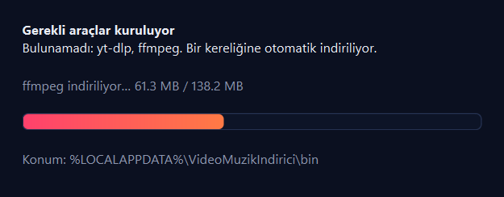
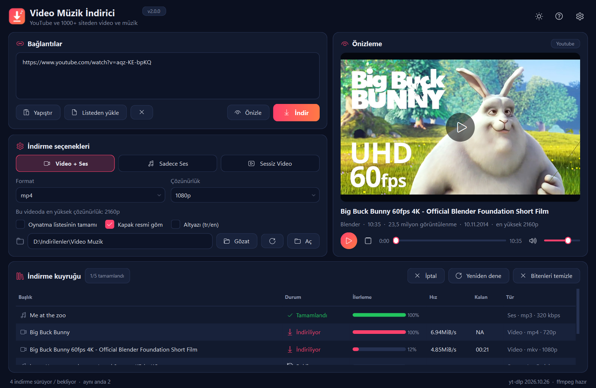
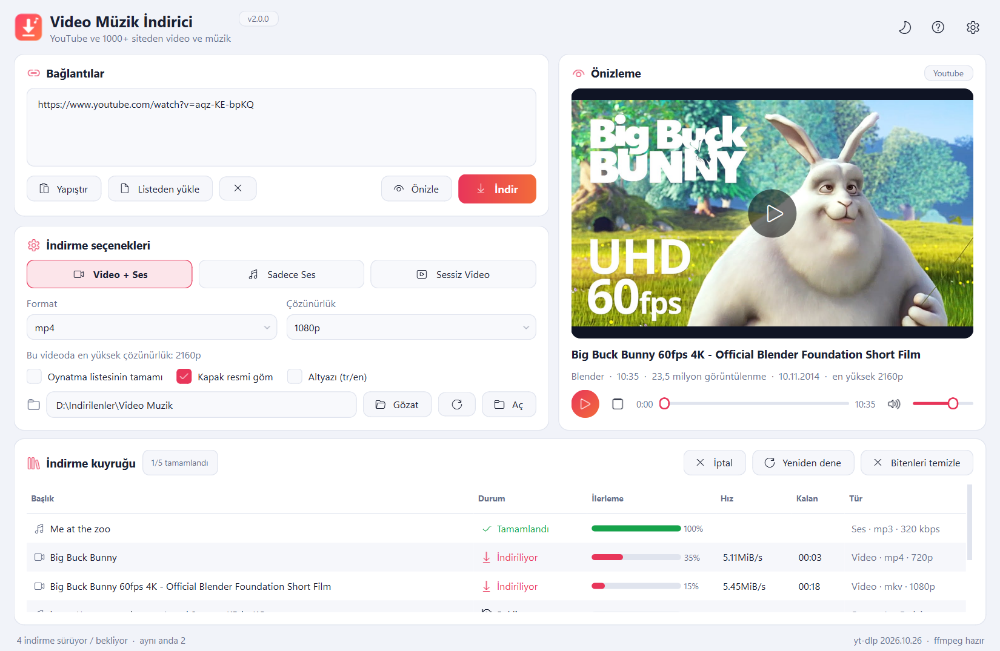
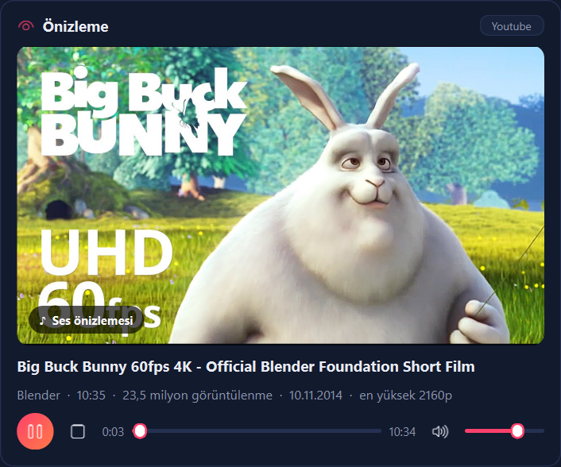
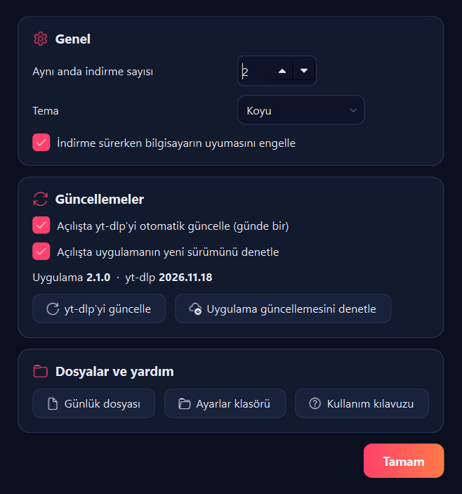
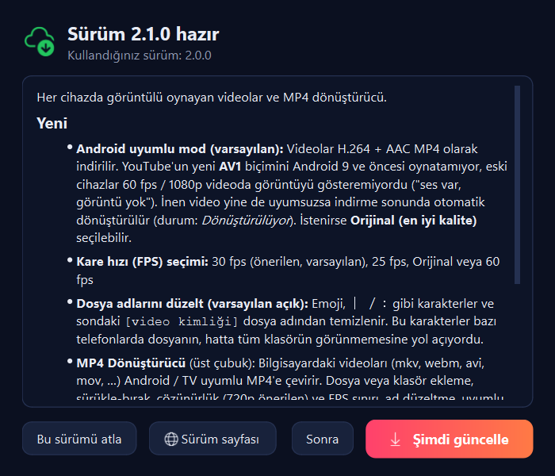
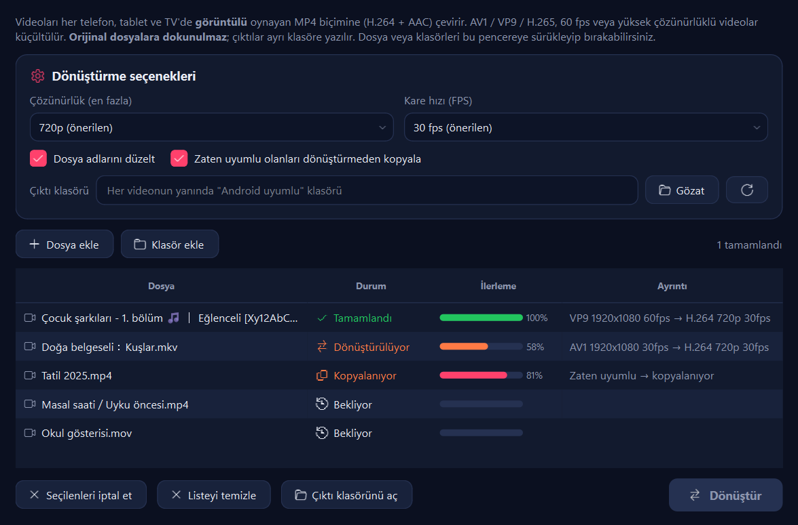

# 📖 Kullanım Kılavuzu

[← Ana sayfa](../README.md) · [Sık Sorulan Sorular](SSS.md) · [Teknik Bilgi](TEKNIK.md)

Bu kılavuz **Video Müzik İndirici 2.1** sürümünü anlatır.

## İçindekiler

1. [Kurulum ve ilk açılış](#1-kurulum-ve-ilk-açılış)
2. [Ekranı tanıyalım](#2-ekranı-tanıyalım)
3. [İlk indirmeniz (adım adım)](#3-ilk-indirmeniz-adım-adım)
4. [Önizleme: indirmeden izleyin ve dinleyin](#4-önizleme-indirmeden-izleyin-ve-dinleyin)
5. [Birden fazla bağlantıyı indirmek](#5-birden-fazla-bağlantıyı-indirmek)
6. [Müzik (sadece ses) indirmek](#6-müzik-sadece-ses-indirmek)
7. [Oynatma listesi indirmek](#7-oynatma-listesi-indirmek)
8. [İndirme kuyruğunu yönetmek](#8-indirme-kuyruğunu-yönetmek)
9. [İndirme yerini değiştirmek](#9-indirme-yerini-değiştirmek)
10. [Ayarlar](#10-ayarlar)
11. [Güncellemeler: uygulama ve yt-dlp](#11-güncellemeler-uygulama-ve-yt-dlp)
12. [Bağlantı kopması, uyku ve kapatma](#12-bağlantı-kopması-uyku-ve-kapatma)
13. [Hangi formatı seçmeliyim?](#13-hangi-formatı-seçmeliyim)
    - [13a. MP4 Dönüştürücü](#13a-mp4-dönüştürücü)
14. [Klavye ve fare kısayolları](#14-klavye-ve-fare-kısayolları)
15. [İpuçları](#15-ipuçları)

---

## 1. Kurulum ve ilk açılış

Video Müzik İndirici kurulum gerektirmez.

1. [Releases sayfasından](https://github.com/mehmet-cizmeci/video-muzik-indirici/releases/latest) **`VideoMuzikIndirici.exe`** dosyasını indirin.
2. Dosyayı kalıcı olarak durmasını istediğiniz, **yazma izniniz olan** bir yere taşıyın (örn. `Belgeler\Programlar` veya Masaüstü). Otomatik güncelleme exe'yi bulunduğu yerde değiştirir; `C:\Program Files` gibi korumalı klasörler önerilmez.
3. Çift tıklayarak açın.

> **SmartScreen uyarısı:** "Windows bilgisayarınızı korudu" penceresi çıkarsa **Ek bilgi**, ardından **Yine de çalıştır**'a tıklayın. Uygulama ücretli bir kod imzalama sertifikasıyla imzalanmadığı için bu uyarı ilk çalıştırmada görünür.

### İlk açılışta otomatik kurulum



Uygulama iki yardımcı programla çalışır: **yt-dlp** (videoyu bulur ve indirir) ve **FFmpeg** (görüntü ile sesi birleştirir, mp3'e dönüştürür, kapak ekler). Bilgisayarınızda bunlar yoksa ilk açılışta yukarıdaki pencere görünür ve ikisi **otomatik indirilir** (~140 MB, bir kereliğine, yönetici izni gerekmez). Kurulum yeri: `%LOCALAPPDATA%\VideoMuzikIndirici\bin`.

> Masaüstüne kısayol: exe'ye sağ tıklayın → **Daha fazla seçenek göster** → **Gönder** → **Masaüstü (kısayol oluştur)**.

---

## 2. Ekranı tanıyalım



Ekran dört karttan oluşur. Kartlar arasındaki boşluklardan tutup sürükleyerek önizleme panelini genişletebilir, kuyruğu büyütebilirsiniz.

### Üst çubuk

| Öğe | Ne yapar |
|---|---|
| **Yeni sürüm x.y.z** (yeşil, yalnızca güncelleme varsa) | Güncelleme penceresini açar |
| **MP4 Dönüştürücü** | Bilgisayardaki videoları Android / TV uyumlu MP4'e çeviren pencereyi açar ([13a](#13a-mp4-dönüştürücü)) |
| ☀ / ☾ | Açık ve koyu tema arasında geçiş yapar |
| ? | Bu kılavuzu tarayıcıda açar |
| ⚙ | Ayarlar penceresini açar |

### ① Bağlantılar

İndirmek istediğiniz bağlantıları yazdığınız kutu: **her satıra bir bağlantı**. Tarayıcının adres çubuğundan bağlantıyı kutuya **sürükleyip bırakabilirsiniz**.

| Düğme | Ne yapar |
|---|---|
| **Yapıştır** | Panodaki bağlantıyı kutuya ekler |
| **Listeden yükle** | Her satırında bir bağlantı olan `.txt` dosyasını kutuya aktarır |
| **✕** | Kutuyu temizler |
| **Önizle** | Kutudaki ilk bağlantının bilgilerini önizleme paneline getirir |
| **İndir** | Kutudaki tüm bağlantıları seçili ayarlarla kuyruğa ekler ve indirmeyi başlatır (Ctrl+Enter) |

Aynı bağlantı iki kez yazılırsa bir kez eklenir; `#` ile başlayan satırlar yok sayılır.

### ② İndirme seçenekleri

| Ayar | Açıklama |
|---|---|
| **Video + Ses / Sadece Ses / Sessiz Video** | İndirme türü. Seçili olan renkli görünür |
| **Format** | Dosya türü: video için mp4/mkv/webm, ses için mp3/m4a/opus/flac/wav |
| **Çözünürlük** / **Ses kalitesi** | Video türlerinde en yüksek çözünürlük; ses türünde bit hızı |
| *Bu videoda en yüksek çözünürlük: …* | Önizlenen videonun sunduğu en yüksek kalite (bilgi amaçlı) |
| **Uyumluluk** | **Android uyumlu (H.264)** (varsayılan): her telefon, tablet ve TV'de görüntülü oynayan MP4 iner; gerekirse indirme sonunda otomatik dönüştürülür. Bu modda format MP4'e sabitlenir. **Orijinal (en iyi kalite)**: sitenin en iyi biçimi (AV1/VP9 olabilir) |
| **Kare hızı (FPS)** | 30 fps (varsayılan), 25 fps, Orijinal veya 60 fps — üst sınırdır |
| **Listenin tamamı** | İşaretliyse oynatma listesindeki tüm videolar indirilir |
| **Kapak resmi** | Küçük resmi dosyaya kapak olarak ekler |
| **Altyazı (tr/en)** | Varsa Türkçe ve İngilizce altyazıyı videoya ekler (yalnızca Video + Ses) |
| **Adları düzelt** | Dosya adından emoji, `｜ ⧸ ：` gibi karakterleri ve sondaki `[video kimliği]`ni temizler (varsayılan açık) |
| **İndirme yeri** | Dosyaların kaydedileceği klasör (Gözat · varsayılana dön · Aç) |

Tüm seçimleriniz **otomatik hatırlanır**. Seçenekler, bağlantıyı **kuyruğa eklediğiniz anda** geçerlidir; kuyruktaki her satır kendi ayarlarını taşır. Böylece bir bağlantıyı mp4, ardından başka birini mp3 olarak ekleyebilirsiniz.

### ③ Önizleme

Bağlantının küçük resmi, başlığı, kanalı, süresi, görüntülenme sayısı, tarihi ve oynatıcı denetimleri. Ayrıntılar: [4. Önizleme](#4-önizleme-indirmeden-izleyin-ve-dinleyin).

### ④ İndirme kuyruğu

| Sütun | Anlamı |
|---|---|
| **Başlık** | Tür ikonu (🎬 video, 🎵 ses) ve videonun başlığı. Oynatma listelerinde `[3/25] Başlık` |
| **Durum** | Renkli durum (aşağıdaki tablo) |
| **İlerleme** | İlerleme çubuğu ve yüzde |
| **Hız** / **Kalan** | Anlık hız ve tahmini kalan süre |
| **Tür** | Satırın ayarları, örn. `Video · mp4 · 1080p` |

| Durum | Renk | Anlamı |
|---|---|---|
| Bekliyor / Başlıyor | normal | Sırası bekleniyor / video bilgileri alınıyor |
| İndiriliyor | kırmızı-pembe | Veri iniyor |
| İşleniyor | turuncu | Görüntü+ses birleştiriliyor veya mp3'e dönüştürülüyor |
| Bağlantı bekleniyor… | sarı | İnternet yok; gelince kendiliğinden devam edecek |
| Yeniden denenecek | sarı | Geçici hata; geri sayım bitince kaldığı yerden devam edecek |
| Tamamlandı | yeşil | Dosya hazır — çift tıklayınca oynar |
| Hata | kırmızı | İndirilemedi — çift tıklayınca sebebi görünür |
| İptal edildi / Duraklatıldı | gri | Sizin tarafınızdan durduruldu |

Kartın sağ üstünde **İptal**, **Yeniden dene** ve **Bitenleri temizle** düğmeleri; başlığın yanında kaç indirmenin tamamlandığı yazar.

### Alt çubuk

Solda kuyruğun durumu (kaç indirme sürüyor, aynı anda kaç indirme), sağda yt-dlp sürümü ve FFmpeg durumu. Pencere başlığındaki `(3)` gibi sayı süren indirme sayısıdır; görev çubuğundan takip edebilirsiniz.

### Açık tema



---

## 3. İlk indirmeniz (adım adım)

1. Tarayıcıda videoyu açın ve adres çubuğundaki bağlantıyı kopyalayın (Ctrl+C). YouTube'un **Paylaş → Kopyala** kısa bağlantıları (`youtu.be/...`) da çalışır.
2. Uygulamada **Yapıştır**'a basın (veya bağlantıyı sürükleyip bırakın).
3. Bir saniye içinde önizleme paneli dolar: başlığı ve küçük resmi kontrol edin. İsterseniz **▶** ile izleyin.
4. **Video + Ses** seçin; **Format: mp4**, **Çözünürlük: 1080p**.
5. **İndir**'e basın. Kuyrukta satır belirir: *Başlıyor → İndiriliyor → İşleniyor → Tamamlandı*.
6. Bitince satıra **çift tıklayın**: video önizleme panelinde oynar. Sağ tık → **Klasörde göster** ile dosyaya ulaşın.

İndirme sürerken pencereyi simge durumuna küçültebilirsiniz. Hepsi bitince sağ altta *"Tüm indirmeler bitti"* bildirimi çıkar ve görev çubuğu simgesi yanıp söner.

---

## 4. Önizleme: indirmeden izleyin ve dinleyin



### Bilgileri görmek

- Kutuya **tek bir bağlantı** yapıştırdığınızda bilgiler **kendiliğinden** gelir (yazmayı bıraktıktan ~1 saniye sonra).
- Kutuda birden fazla bağlantı varsa **Önizle** düğmesi ilkini getirir. Kuyruktaki bir satırı seçip **Önizle**'ye basmak da o bağlantıyı gösterir.
- Gösterilenler: başlık, kanal, süre, görüntülenme sayısı, yükleme tarihi, küçük resim, site adı ve videonun **en yüksek çözünürlüğü**.
- Oynatma listelerinde listenin adı, öğe sayısı ve ilk öğe gösterilir. "Oynatma listesinin tamamı" işaretli değilse bir hatırlatma çıkar.

### Oynatmak

| Denetim | İşlev |
|---|---|
| **▶ / ❚❚** (veya küçük resme tıklamak) | Oynat / duraklat |
| **■** | Durdur ve başa sar |
| Zaman çubuğu | İleri-geri sarma |
| 🔊 ve ses çubuğu | Sesi kapat/aç, ses düzeyi |

- **Video + Ses** veya **Sessiz Video** seçiliyken video oynar (önizleme için en fazla ~480p akış kullanılır, hızlı başlasın diye).
- **Sadece Ses** seçiliyken yalnızca ses çalar; küçük resmin üzerinde **"♪ Ses önizlemesi"** yazar.
- Önizleme **hiçbir şey indirmez** ve indirme kuyruğunu etkilemez.

### İndirilen dosyaları oynatmak

Kuyrukta **Tamamlandı** durumundaki bir satıra **çift tıklayın** (veya sağ tık → **Önizle (oynat)**): dosya önizleme panelinde oynar. Panelin sağ üstünde **"Yerel dosya"** yazar.

---

## 5. Birden fazla bağlantıyı indirmek

**Kutuya yazarak:** bağlantıları alt alta yapıştırın. Virgül veya boşlukla ayrılmış olsalar da ayrıştırılır.

**Metin dosyasından:** Not Defteri'nde hazırlayın ve **Listeden yükle** ile seçin:

```
# Gezi videoları
https://www.youtube.com/watch?v=aaaaaaaaaaa
https://www.youtube.com/watch?v=bbbbbbbbbbb

# Müzikler
https://www.youtube.com/watch?v=ccccccccccc
```

**Sürükle-bırak:** tarayıcıdaki bağlantıları uygulama penceresinin üzerine bırakın.

> Bir kısmını video, bir kısmını müzik olarak indirmek için iki parti halinde ekleyin: önce video bağlantılarını **Video + Ses** ile, sonra müzikleri **Sadece Ses** ile.

---

## 6. Müzik (sadece ses) indirmek

1. **Sadece Ses**'i seçin.
2. **Format: mp3** (her cihazda çalar) — diğerleri için [13. bölüm](#13-hangi-formatı-seçmeliyim).
3. **Ses kalitesi: En iyi**.
4. **Kapak resmi göm** işaretli kalsın: telefonda albüm kapağı görünür.

İndirmeden önce **▶** ile şarkının doğru olduğunu dinleyerek kontrol edebilirsiniz.

> **"En iyi" mi "320 kbps" mi?** YouTube'daki ses zaten ~160 kbps kalitededir. mp3 için `En iyi`, yüksek kaliteli değişken bit hızı kullanır ve çoğu durumda en iyi seçimdir; 320 dosyayı büyütür ama kaliteyi artırmaz.

---

## 7. Oynatma listesi indirmek

1. Liste bağlantısını kopyalayın (adresinde `list=` geçen).
2. **Oynatma listesinin tamamı** kutusunu işaretleyin.
3. Türü ve formatı seçip **İndir**'e basın.

Dosyalar indirme klasörünüzün içinde **listenin adıyla bir alt klasöre**, sıra numarasıyla kaydedilir:

```
Video Muzik Indirici\
└── Benim Listem\
    ├── 001 - İlk şarkı [aaaaaaaaaaa].mp3
    ├── 002 - İkinci şarkı [bbbbbbbbbbb].mp3
    └── 003 - Üçüncü şarkı [ccccccccccc].mp3
```

Kuyrukta liste **tek satır** olarak görünür; başlıkta o an inen öğe `[2/25] Şarkı adı` biçiminde yazar. Kesilen bir liste yeniden başladığında inmiş dosyaları atlar.

---

## 8. İndirme kuyruğunu yönetmek

### Sağ tık menüsü

| Menü | Ne yapar |
|---|---|
| **Önizle (oynat)** | Tamamlandıysa dosyayı, değilse bağlantıyı önizlemede açar |
| **Dosyayı aç** | İnen dosyayı Windows'un varsayılan programıyla açar |
| **Klasörde göster** | Dosyayı Gezgin'de seçili gösterir |
| **İptal et** | İndirmeyi durdurur |
| **Yeniden dene** | Hatalı/iptal edilmiş indirmeyi kaldığı yerden yeniden başlatır |
| **Hata ayrıntısı** | Hatanın sebebini ve yt-dlp'nin son mesajlarını gösterir |
| **Bağlantıyı kopyala** | Seçili satırların bağlantılarını panoya kopyalar |
| **Listeden kaldır** | Biten/hatalı satırları listeden siler (dosya silinmez) |

Ctrl veya Shift ile **birden fazla satır** seçip toplu işlem yapabilirsiniz. **Delete** tuşu seçili indirmeleri iptal eder.

### Aynı anda kaç indirme?

**Ayarlar → Aynı anda indirme sayısı** (1–5). İndirme sürerken de değiştirilebilir.

| İnternet hızı | Öneri |
|---|---|
| < 20 Mbps | 1 |
| 20–100 Mbps | 2 (varsayılan) |
| > 100 Mbps | 3–4 |

---

## 9. İndirme yerini değiştirmek

- **Gözat** → bir klasör seçin; seçim kaydedilir.
- **↻** (varsayılana dön) → `İndirilenler\Video Muzik Indirici`.
- **Aç** → indirme klasörünü Gezgin'de açar (yoksa oluşturur).

Yolu kutuya elle de yazabilirsiniz. Dosya adları `Video başlığı [video-kimliği].uzantı` biçimindedir; köşeli parantezdeki kimlik, aynı başlıklı farklı videoların birbirinin üzerine yazılmasını önler.

---

## 10. Ayarlar

Sağ üstteki ⚙ ile açılır.



| Ayar | Açıklama |
|---|---|
| **Aynı anda indirme sayısı** | Paralel indirme sayısı (1–5) |
| **Tema** | Koyu veya Açık (üst çubuktaki ☀/☾ ile de değişir) |
| **İndirme sürerken bilgisayarın uyumasını engelle** | İndirme bitene kadar otomatik uykuyu önler |
| **Açılışta yt-dlp'yi otomatik güncelle** | Günde en fazla bir kez |
| **Açılışta uygulamanın yeni sürümünü denetle** | GitHub'daki son sürüme bakar |
| **yt-dlp'yi güncelle** | İndirme motorunu hemen günceller |
| **Uygulama güncellemesini denetle** | Yeni sürümü hemen denetler |
| **Günlük dosyası / Ayarlar klasörü / Kullanım kılavuzu** | İlgili dosyayı, klasörü veya bu sayfayı açar |

**Tamam**'a basınca ayarlar kaydedilir.

---

## 11. Güncellemeler: uygulama ve yt-dlp

### Uygulamanın kendisi



1. Uygulama açılırken GitHub'daki son sürümü denetler. Yeni sürüm varsa sağ altta bir bildirim çıkar ve sağ üstte yeşil **"Yeni sürüm x.y.z"** düğmesi belirir.
2. Düğmeye basınca sürüm notlarını gösteren pencere açılır (yukarıdaki görüntüdeki notlar örnektir):
   - **Şimdi güncelle** — yeni exe indirilir, boyutu ve **SHA-256 özeti doğrulanır**, uygulama kendini değiştirir ve yeniden açılır. Açılışta *"Uygulama x.y.z sürümüne güncellendi"* bildirimi görünür.
   - **Sürüm sayfası** — GitHub'daki sürüm sayfasını açar.
   - **Bu sürümü atla** — bu sürüm için bir daha hatırlatmaz (daha yeni bir sürüm çıkınca yine haber verir).
   - **Sonra** — pencereyi kapatır; düğme yerinde kalır.
3. Güncelleme sırasında süren indirmeler varsa uygulama onay ister; indirmeler kaydedilir ve yeniden açılışta **kaldığı yerden** devam eder.

Elle denetlemek için: **Ayarlar → Uygulama güncellemesini denetle**. Otomatik denetimi aynı pencereden kapatabilirsiniz.

> Güncelleme, exe'nin bulunduğu klasöre yazabilmeyi gerektirir. Exe'yi korumalı bir klasöre koyduysanız uygulama bunu söyler; o durumda yeni sürümü sürüm sayfasından elle indirin.

### yt-dlp (indirme motoru)

YouTube ve diğer siteler sık değişir; **"bir anda hiçbir video inmiyor"** durumunun en yaygın sebebi eski yt-dlp'dir. Uygulama açılışta günde bir kez otomatik günceller; **Ayarlar → yt-dlp'yi güncelle** ile elle de güncelleyebilirsiniz. İndirme sürerken yt-dlp güncellenemez.

---

## 12. Bağlantı kopması, uyku ve kapatma

**Sizin bir şey yapmanıza gerek yoktur.**

- **İnternet koptuğunda:** satır sarı **"Bağlantı bekleniyor…"** olur; bağlantı gelince yarım dosyadan **kaldığı yerden** devam eder.
- **Uyku:** uyku engelleme açıksa indirme sürerken Windows kendiliğinden uyumaz. Kapağı kapatırsanız uyandığınızda askıda kalan indirme **90 saniye içinde** fark edilip kaldığı yerden yeniden başlatılır. (Uyku engelleme ekranın kapanmasını engellemez.)
- **Kapatma:** indirme sürerken pencereyi kapatırsanız uygulama sorar; **Evet** derseniz indirmeler kaydedilir ve sonraki açılışta kendiliğinden sürer. Bilgisayar beklenmedik şekilde kapansa da aynı şey olur.
- **Ne zaman vazgeçer?** Video silinmiş/gizli/bölgede engelli, bağlantı geçersiz veya üyelik gerektiren içeriklerde boşuna denemez ve **Hata** gösterir. İnternet varken art arda 8 kez hiç ilerleme olmazsa da durur.

---

## 13. Hangi formatı seçmeliyim?

### Video

| Format | Ne zaman? |
|---|---|
| **mp4** ✅ | Çoğu kişi için en iyisi; telefon, TV, Windows — her yerde açılır |
| **mkv** | En yüksek kalite (1440p/4K genelde yalnızca bu yolla), altyazı desteği güçlü |
| **webm** | Web için; tarayıcılarda doğrudan oynar |

### Ses

| Format | Ne zaman? |
|---|---|
| **mp3** ✅ | Her cihazda çalar; müzik arşivi için en pratik seçim |
| **m4a** | Apple cihazlar için ideal; mp3'ten biraz daha verimli |
| **opus** | Aynı boyutta en iyi kalite; YouTube'un orijinal ses formatı |
| **flac** | Kayıpsız kapsayıcı (kaynak kayıplı olduğu için kalite artmaz, dosya büyür) |
| **wav** | Ses düzenleme programları için; çok büyük dosyalar, kapak eklenemez |

> **Video telefonda/TV'de sesli ama görüntüsüz mü?** Uyumluluk **Android uyumlu**, kare hızı **30 fps** ve çözünürlük **720p** olarak kalsın. Önceden indirilmiş videoları [MP4 Dönüştürücü](#13a-mp4-dönüştürücü) ile düzeltebilirsiniz.

---

## 13a. MP4 Dönüştürücü

Üst çubuktaki **MP4 Dönüştürücü** düğmesi, bilgisayarınızdaki videoları (mkv, webm, avi, mov, mp4…) her cihazda görüntülü oynayan MP4'e (H.264 + AAC) çevirir.



1. **Dosya ekle** veya **Klasör ekle**'ye basın ya da videoları pencereye sürükleyin.
2. **Çözünürlük** (en fazla; 720p önerilir, küçük videolar büyütülmez) ve **Kare hızı** seçin.
3. **Dosya adlarını düzelt** ve **Zaten uyumlu olanları dönüştürmeden kopyala** kutuları varsayılan olarak açıktır.
4. **Çıktı klasörü** boş bırakılırsa her videonun yanında **`Android uyumlu`** klasörü oluşturulur.
5. **Dönüştür**'e basın. Her satırda ilerleme ve "AV1 1080p 60fps → H.264 720p 30fps" gibi bir açıklama görünür.

- **Orijinal dosyalara dokunulmaz**; aynı adda dosya varsa yeni dosya `(2)` ekiyle kaydedilir.
- Pencereyi kapatsanız da dönüştürme arka planda sürer; düğmeye basınca pencere geri gelir.
- Satıra çift tıklamak çıktı dosyasını klasörde gösterir; hatalı satırda hata ayrıntısını açar.
- **Seçilenleri iptal et** süren dönüştürmeyi durdurur, yarım dosyayı siler.

---

## 14. Klavye ve fare kısayolları

| Kısayol | İşlev |
|---|---|
| `Ctrl + Enter` | Kuyruğa ekle ve indir |
| `Ctrl + V` (bağlantı kutusunda) | Yapıştır |
| Sürükle-bırak (pencereye) | Bağlantıyı kutuya ekle |
| `Delete` (kuyrukta) | Seçili indirmeleri iptal et |
| Çift tık (tamamlanan satır) | Dosyayı önizlemede oynat |
| Çift tık (hatalı satır) | Hata ayrıntısını göster |
| Çift tık (diğer satırlar) | Bağlantıyı önizle |
| Küçük resme tık | Oynat / duraklat |
| Sağ tık (satır) | Bağlam menüsü |

---

## 15. İpuçları

- **İndirmeden önce dinleyin:** müzik listelerinde doğru şarkı olduğundan emin olmak için ▶ ile birkaç saniye dinleyin.
- **Gece indirme:** uzun bir listeyi kuyruğa ekleyip uyku engelleme açıkken bırakabilirsiniz; kopmalar kendiliğinden toparlanır.
- **Kalite / boyut:** telefonda 720p, büyük ekranda 1080p çoğu zaman yeterlidir; 4K dosyalar 1080p'nin 3–4 katıdır.
- **Aynı videoyu tekrar indirmek:** dosya zaten varsa yt-dlp atlar; yeniden indirmek için eski dosyayı silin veya başka klasör seçin.
- **Hata alırsanız önce güncelleyin:** Ayarlar → yt-dlp'yi güncelle → Yeniden dene.
- **Göz yormayan tema:** gece koyu, gündüz açık tema için üst çubuktaki ☀/☾ düğmesini kullanın.
- **Günlük dosyası:** her indirmenin sonucu `%APPDATA%\VideoMuzikIndirici\indirici.log` dosyasına yazılır; sorun bildirirken ilgili kısmı eklemek çok yardımcı olur.

Sorununuz burada yoksa: [Sık Sorulan Sorular ve Sorun Giderme](SSS.md)
